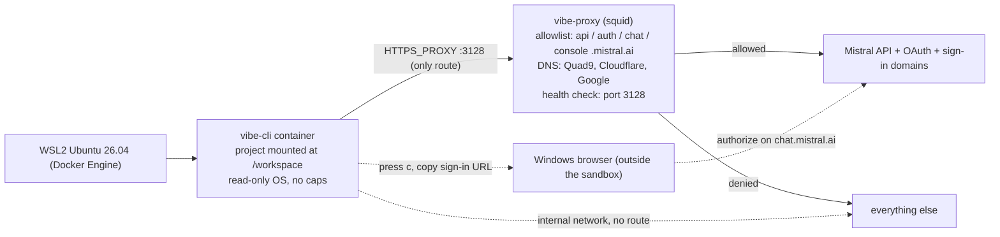

# Vibe CLI in Docker on WSL2 — locked-down setup

Goal: run the **Vibe Code CLI** (`mistral-vibe`) as a Docker container inside your Ubuntu 26.04 WSL2 distro, with two hard restrictions:

1. **Network**: the CLI may talk to Mistral only — `api.mistral.ai` for the API, `auth.mistral.ai` for OAuth token exchange, plus `chat.mistral.ai` and `console.mistral.ai` for browser OAuth sign-in — and nothing else.
2. **Filesystem**: the CLI sees only the project you launch it from.

## Architecture



Two profiles, chosen by which wrapper you call — nothing starts automatically in either:

- **`vibe` (default, restricted):** the locked profile below. Proxy allowlist, Mistral-only egress.
- **`vibe-open` (unrestricted):** the same container, same project-only filesystem, but on a normal Docker network with no proxy — full internet access on demand.

How each requirement is enforced (defense in depth — no single layer is trusted):

| Requirement | Enforcement |
|---|---|
| Only Mistral domains reachable | `vibe-cli` sits on a Docker network with `internal: true` (no direct internet at all). Its only egress is the `HTTPS_PROXY`. The proxy is a squid with an allowlist of exactly `api.mistral.ai`, `auth.mistral.ai`, `chat.mistral.ai`, and `console.mistral.ai` (all TLS-only). Squid resolves the CONNECT hostname itself and connects to the real IP, so the CLI cannot bypass the list by lying about a hostname. |
| Browser OAuth works headless | The sign-in flow is polling-based, not a loopback redirect: the CLI shows a URL, you authorize in your **Windows** browser (which lives outside the sandbox), and the CLI polls the sign-in domains through the proxy until it succeeds. `BROWSER=true` in the container works around a known bug where the CLI aborts the flow when it can't launch a browser ([#941](https://github.com/mistralai/mistral-vibe/issues/941)). |
| Only the current project visible | Exactly one project bind mount (`$PWD` → `/workspace`). Everything else in the container is throwaway. Read-only root filesystem, all capabilities dropped, `no-new-privileges`, and CLI config sets `outside_workdir = "deny"`. |
| No telemetry / update / web traffic | `config.toml` sets `enable_telemetry = false` and `enable_update_checks = false`; built-in web tools are disabled. The proxy blocks them regardless. |
| Auditable | Every denied/allowed connection is logged: `docker compose exec proxy tail -f /var/log/squid/access.log`. |

Key design decisions (stated so you can veto them):

- **Both sign-in paths supported.** Browser OAuth (default, zero setup) **or** an API key from `chat.mistral.ai/code/extensions` for automation. Two gotchas the base docs don't mention: the egress allowlist must include the sign-in domains (`auth.mistral.ai`, `chat.mistral.ai`, `console.mistral.ai`), and inside a container the CLI can't open a browser — and, due to a known bug, aborts the flow instead of just showing the URL and polling. `BROWSER=true` fixes that ([#941](https://github.com/mistralai/mistral-vibe/issues/941)). An API key in `.env` **overrides** browser credentials, so keep exactly one active.
- **Docker Engine installed inside the distro**, not Docker Desktop. Desktop runs containers in its own managed VM, which technically isn't "in this distribution".
- **Nothing runs until you ask it to.** No restart policies anywhere: no container starts at WSL or Docker boot. The `vibe` wrapper starts the `proxy` service on demand and stops it again when the session ends (`vibe-open` has no daemon dependencies at all). The only thing that auto-starts is the Docker *daemon* itself, which `systemctl enable docker` in Step 1 turns on with the distro — run `sudo systemctl disable docker` too if you want even that manual.
- **Update = rebuild.** The container can't self-update (by design). You bump a pinned version and rebuild.

Docs references: [Install the Vibe CLI](https://docs.mistral.ai/getting-started/quickstarts/vibe-code/install-cli) · [Install and setup (sign-in paths)](https://docs.mistral.ai/vibe/code/cli/install-setup) · [Configuration reference](https://docs.mistral.ai/vibe/code/cli/configuration-reference) · [Safety, approvals, permissions](https://docs.mistral.ai/vibe/code/safety-approvals-permissions)

---

## Step 0 — Prerequisites

- Windows with WSL2, Ubuntu 26.04 LTS distro, systemd enabled (Step 1's script handles it).
- Authentication: your Mistral account for browser sign-in (nothing to create), and/or an API key from `chat.mistral.ai/code/extensions` (Code › Vibe CLI) if you want headless automation.
- Your WSL user's UID/GID (usually `1000`/`1000` — check with `id -u`, `id -g`).

## Step 1 — Install Docker Engine in the distro (skip if present)

Run the script below. See `install-docker.sh` for the complete implementation.

**Script:** `install-docker.sh`
**Purpose:** Installs Docker Engine inside the WSL2 Ubuntu distro (not Docker Desktop), enables systemd, adds your user to the docker group, and starts the Docker service.

```bash
bash install-docker.sh
```

## Step 2 — Create the project tree

```bash
mkdir -p ~/vibe-docker/{cli,proxy,home/.vibe,placeholder}
cd ~/vibe-docker
```

Then create the following files (all templates provided):

```
~/vibe-docker/
├── .env                  # API key + build args (chmod 600)
├── docker-compose.yml    # profile 1: restricted (proxy allowlist)
├── docker-compose.open.yml  # profile 2: no web restriction
├── vibe                  # wrapper, restricted profile
├── vibe-open             # wrapper, unrestricted profile
├── verify-isolation.sh   # self-test of the network jail
├── placeholder/          # empty; mounted as /workspace only if you bypass the wrappers
├── cli/
│   └── Dockerfile        # CLI container build instructions
├── proxy/
│   ├── Dockerfile        # Proxy container build instructions
│   └── squid.conf        # Squid proxy configuration with Mistral allowlist
└── home/                 # mounted as the container's $HOME
    ├── .vibe/
    │   └── config.toml    # Vibe CLI configuration
    └── .gitconfig         # Git configuration
```

### File Descriptions

| File | Purpose |
|------|---------|
| `.env` | Environment variables including `MISTRAL_API_KEY`, `UID`, `GID`, and `VIBE_VERSION`. Keep this file secure (`chmod 600`). |
| `docker-compose.yml` | Docker Compose configuration for the restricted profile. Defines `proxy` and `cli` services with internal networking and Mistral-only egress via the proxy. |
| `docker-compose.open.yml` | Docker Compose configuration for the unrestricted profile. Same container setup but with normal internet access (no proxy). |
| `cli/Dockerfile` | Builds the Vibe CLI container using Ubuntu 24.04, installs dependencies, and sets up the vibe tool via uv. |
| `proxy/Dockerfile` | Builds the Squid proxy container from Ubuntu 24.04 and installs Squid. |
| `proxy/squid.conf` | Squid configuration that enforces a strict allowlist: only `api.mistral.ai`, `auth.mistral.ai`, `chat.mistral.ai`, and `console.mistral.ai` are accessible, TLS only. |
| `home/.vibe/config.toml` | Vibe CLI configuration disabling telemetry, update checks, web tools, and enforcing `outside_workdir = "deny"`. |
| `home/.gitconfig` | Git user configuration for commits from within the container. |
| `vibe` | Wrapper script that sets up the environment and launches the CLI with the restricted profile (via proxy). |
| `vibe-open` | Wrapper script that launches the CLI with the unrestricted profile (no proxy, full internet). |
| `verify-isolation.sh` | Test script to verify the network isolation is working correctly. |

## Step 3 — Build and verify

**Script:** `verify-isolation.sh`
**Purpose:** Proves the network jail by testing connectivity to Mistral domains (should succeed) and blocked domains (should fail).

```bash
cd ~/vibe-docker
chmod 600 .env
chmod +x vibe vibe-open verify-isolation.sh
docker compose build                              # restricted profile
docker compose -f docker-compose.open.yml build   # open profile (same image spec)
./verify-isolation.sh
```

Expected results:

- Test 1 prints HTTP codes for all three domains (`401` from `api.mistral.ai/v1/models` is expected and fine — curl didn't send your key; any code proves the pipe works).
- Tests 2 and 3 print `blocked (good)` everywhere.
- Test 4 prints `200` — proof that unrestricted access is a deliberate, separate command away, not the default.

Optionally make the wrappers global:

```bash
mkdir -p ~/.local/bin
ln -s ~/vibe-docker/vibe ~/.local/bin/vibe
ln -s ~/vibe-docker/vibe-open ~/.local/bin/vibe-open
```

## Step 4 — First sign-in (browser OAuth)

With an empty `MISTRAL_API_KEY` in `.env`:

```bash
cd ~/vibe-docker && docker compose build   # if not done yet
cd ~/projects/whatever-is-in-development
vibe --setup          # or just `vibe` on a fresh ./home
```

1. Pick a theme, then choose **Launch browser**.
2. The TUI can't open a browser (there isn't one) — with `BROWSER=true` it simply shows the sign-in URL instead of aborting. Press `c` to copy it.
3. Paste the URL into your **Windows browser**, sign in with your Mistral account, and approve.
4. Back in the TUI, the CLI polls the sign-in domains through the proxy, completes the flow, and stores the provisioned credentials under `./home/.vibe` (no OS keyring in the container). Future sessions reuse them — no port forwarding, no redirect into the sandbox, the flow is polling-based.

To switch to API-key mode later: put the key in `.env` (it overrides stored OAuth credentials). To switch back: empty it and run `vibe --setup`.

## Step 5 — Daily usage

```bash
cd ~/projects/whatever-is-in-development
vibe                                    # restricted: Mistral-only egress
vibe --prompt "explain the failing test in tests/login.py"   # one-shot
vibe --agent ask                        # vet every tool call first (safest)
vibe-open                               # unrestricted internet, same sandbox fs
```

Rule of thumb: default to `vibe`; reach for `vibe-open` only when a task genuinely needs outside access (installing deps, fetching docs, hitting a git remote). Note that both profiles share `./home/.vibe/config.toml`, which disables the built-in web tools — if you want `web_fetch`/`web_search` back in the open profile, remove those lines from `config.toml` (in the restricted profile the proxy blocks them either way).

Only the directory you launch from is exposed. Everything else — other projects, your dotfiles, your SSH keys — doesn't exist from the container's point of view.

## Step 6 — Updating the CLI

The sandbox can't self-update (deliberately). Update = pin + rebuild:

```bash
# 1. Set VIBE_VERSION=x.y.z in ~/vibe-docker/.env
cd ~/vibe-docker
docker compose build cli
docker compose -f docker-compose.open.yml build cli
./verify-isolation.sh        # re-prove the sandbox after every rebuild
```

To roll back, set the previous version and rebuild again.

---

## Limitations and honest notes

- **No package installs at runtime — in the restricted profile.** If the agent tries `pip install x` through `vibe`, the proxy kills it. That's the point. Either put your project's dependencies in `cli/Dockerfile` and rebuild, or switch that task to `vibe-open`, which has unrestricted egress by design.
- **The open profile is one command away from full internet.** The isolation boundary there is only the filesystem (working-directory mount, read-only rootfs, dropped capabilities). If that trade-off ever stops being acceptable, delete `docker-compose.open.yml` and `vibe-open` — the restricted profile is fully self-sufficient.
- **OAuth widens the allowlist from one domain to four.** Still Mistral-only, still TLS-only — but the CLI can now reach the sign-in surfaces (`auth.mistral.ai`, `chat.mistral.ai`, `console.mistral.ai`) and the model API (`api.mistral.ai`). Token refreshes happen through the same proxy and are visible in the squid access log.
- **`BROWSER=true` is a bug workaround, not a hack you invented.** [Issue #941](https://github.com/mistralai/mistral-vibe/issues/941): as of CLI 2.26 (Oct 2026) the browser sign-in aborts in headless environments instead of showing the URL and polling. If a later release fixes it, the env var degrades into a harmless no-op (Python's `webbrowser` treats `true` as the browser to "launch").
- **Your credentials live in two possible places.** API-key mode: `.env` on the host — `chmod 600` it, keep it out of any repo. OAuth mode: `./home/.vibe` — same protection rules apply. The container only ever sees them as environment/files in `$HOME`.
- **The proxy is a single point of failure.** If the `proxy` container is down, the CLI is offline — safe direction to fail in.
- **If the CLI ever trips over the read-only rootfs** (some tools insist on writing to odd paths), set `read_only: false` in the compose file. You lose one hardening layer but keep the network jail, the mount boundary, and `outside_workdir = "deny"`.
- **Allowlist maintenance.** If Mistral ever moves to a new endpoint domain, the CLI will fail with connection errors. Fix: add the domain to `allowed_dst` in `squid.conf`, then rebuild and recreate the proxy. The current allowlist includes `api.mistral.ai`, `auth.mistral.ai`, `chat.mistral.ai`, and `console.mistral.ai`.
- **Proxy DNS and reliability.** The proxy service uses Quad9, Cloudflare, and Google DNS servers to ensure domain resolution works in restricted environments. A health check verifies the proxy is listening on port 3128 before the CLI starts, preventing race conditions on subsequent runs. The proxy container also removes stale PID files on startup to avoid exit code errors. Configuration is in `proxy/Dockerfile` and `docker-compose.yml`.
- **WSL boot behavior:** after `wsl --shutdown`, nothing comes back up on its own — no restart policies exist. The `vibe` wrapper starts the `proxy` service on demand, so the next `vibe` invocation just works (provided the Docker service starts with the distro, which `systemctl enable docker` in Step 1 ensures).
- **Version pinning:** the docs install `mistral-vibe` unpinned. For a security-sensitive sandbox, pin `VIBE_VERSION` after the first successful run — otherwise a rebuild silently pulls a new CLI version.
